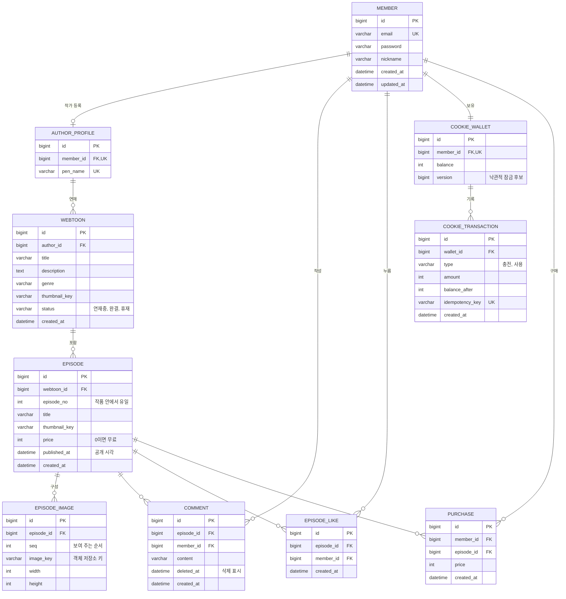

# ERD 설계

> 상태: **초안 (결정 전)** · 결정이 끝난 항목은 "결정" 칸을 채우고, 큰 결정은 `docs/adr/`에 기록한다.

## 1. 초안 ERD

아래 그림은 결정 항목에서 **추천안을 적용했을 때의 모습**이다. 결정이 바뀌면 그림도 같이 고친다.

## 2. 설계 결정 항목

각 항목은 **개념 단계에서 함께 고민한 뒤** 결정한다. 추천안은 출발점일 뿐이다.

### A. 공통

#### A1. 기본 키 전략
| 선택지 | 장점 | 단점 |
|---|---|---|
| 정수 자동 증가 (BIGINT) | 작고 빠름, 삽입이 순차적이라 인덱스 효율이 좋음 | 주소에 노출되면 전체 규모와 순서가 드러남 |
| 무작위 UUID | 추측 불가, 분산 생성 가능 | InnoDB는 기본 키 순서로 데이터를 저장해서, 무작위 값이면 삽입마다 페이지 분할이 생기고 느려짐 |
| 시간 순 UUID (v7) | 추측 어려움 + 대체로 순차 삽입 | 16바이트라 보조 인덱스까지 커짐 |

- **추천**: 정수 자동 증가
- **고민할 점**: 왜 InnoDB에서 기본 키 선택이 삽입 성능에 영향을 주는가 (클러스터드 인덱스)
- **결정**:

#### A2. 시간 컬럼 타입과 시간대
- 선택지: `DATETIME(6)` / `TIMESTAMP`
- `TIMESTAMP`는 2038년 한계가 있고 세션 시간대에 따라 변환된다
- **추천**: `DATETIME(6)`, 저장은 한국 시간 또는 UTC 중 하나로 통일하고 설정에 명시
- **결정**:

#### A3. 외래 키 제약을 DB에 걸 것인가
| 선택지 | 장점 | 단점 |
|---|---|---|
| 건다 | 데이터 무결성을 DB가 보장 | 자식 행 삽입 시 부모 행에 공유 잠금이 걸림. 대량 삭제 순서가 까다로움 |
| 걸지 않는다 (실무에서 흔함) | 잠금 경합 감소, 샤딩·이관에 유리 | 무결성을 애플리케이션이 책임져야 함 |

- **추천**: 건다. 학습 단계에서는 무결성을 먼저 확보하고, 문제가 측정되면 그때 판단한다
- **연결 과제**: 과제 4. 좋아요를 삽입하면 외래 키 때문에 회차 행에 공유 잠금이 걸리고, 같은 트랜잭션에서 회차의 좋아요 수를 갱신하면(배타 잠금) 동시 요청끼리 **교착 상태**가 날 수 있다. 직접 재현해 볼 가치가 큰 주제다
- **결정**:

#### A4. 삭제 방식
- 선택지: 실제 삭제 / 삭제 표시(`deleted_at`)
- 삭제 표시는 복구와 이력 보존에 좋지만, 모든 조회에 조건이 붙고 유니크 제약과 충돌한다
- **추천**: 댓글만 삭제 표시, 나머지는 실제 삭제
- **결정**:

### B. 도메인 구조

#### B1. 작가를 어떻게 표현할 것인가
| 선택지 | 설명 |
|---|---|
| 회원에 역할 컬럼 | 단순. 작가 전용 정보(필명 등)를 둘 곳이 애매함 |
| 작가 프로필 테이블 분리 (1:1 선택적) | 작가만 가진 정보를 분리. 작품은 작가 프로필을 참조 |

- **추천**: 작가 프로필 분리
- **결정**:

#### B2. 회차 이미지 저장
- 선택지: 별도 테이블 / 회차 테이블에 JSON 컬럼
- **추천**: 별도 테이블. 순서(`seq`)를 두고, 전체 주소가 아니라 **객체 저장소 키만 저장**한다. CDN 도메인이 바뀌어도 데이터를 고칠 필요가 없다
- **결정**:

#### B3. 회차 공개 상태
- 선택지: 상태 컬럼(임시저장, 예약, 공개) / 공개 시각 컬럼 하나
- 공개 시각만 두면 "공개된 회차"는 `published_at <= 현재 시각`으로 판단할 수 있고, 예약 공개가 자연스럽게 해결된다
- **추천**: 공개 시각 컬럼. 인덱스 후보 `(webtoon_id, published_at)`
- **고민할 점**: 공개 시각이 지나는 순간 캐시는 어떻게 갱신되는가 (과제 3)
- **결정**:

#### B4. 장르
- 선택지: 단일 문자열 컬럼 / 장르 테이블 + 중간 테이블(다대다)
- **추천**: 단일 컬럼. 다중 장르는 범위 밖
- **결정**:

### C. 성능·동시성 과제와 직접 연결되는 결정

이 항목들은 **나중에 개선할 대상이 될 수 있다.** 처음부터 최적의 답을 넣으면 개선할 것이 없고, 일부러 나쁘게 만들면 의미가 없다. 원칙은 **"지금 단계에서 합리적인 단순한 설계로 시작하고, 측정 결과로 바꾼다"** 이다.

#### C1. 좋아요 수, 조회수를 어디에 둘 것인가
| 선택지 | 장점 | 단점 |
|---|---|---|
| 매번 `COUNT` | 항상 정확, 구조 단순 | 데이터가 쌓일수록 느려짐 |
| 회차 테이블에 카운트 컬럼 | 조회가 빠름 | 갱신 경합, 정합성 관리 필요 |
| Redis에 집계 후 주기적 반영 | 쓰기 부하 분산 | 일시적 불일치, 구조 복잡 |

- **추천**: 처음엔 `COUNT`로 시작 → 과제 4에서 측정 후 변경
- **결정**:

#### C2. 좋아요 중복 방지
- `(member_id, episode_id)` 유니크 제약으로 DB가 보장
- **고민할 점**: 애플리케이션에서 "이미 눌렀는지 조회 후 삽입"만으로는 왜 부족한가
- **결정**:

#### C3. 쿠키 잔액 관리
| 선택지 | 설명 |
|---|---|
| 회원 테이블에 잔액 컬럼 | 단순. 이력이 없어 문제 추적 불가 |
| 지갑 테이블 + 거래 원장 | 잔액과 모든 변동 이력을 함께 보관. 잔액이 원장 합계와 일치하는지 검증 가능 |

- **추천**: 지갑 + 원장. 원장에 멱등키 유니크 제약을 두면 재시도 요청의 중복 처리를 막을 수 있다
- **결정**:

#### C4. 구매 중복 방지
- `(member_id, episode_id)` 유니크 제약을 걸 것인가
- 걸면 같은 회차 중복 구매는 DB가 막아 준다. 다만 **과제 5의 일부가 제약 하나로 해결**되므로, 잔액 차감 쪽 동시성 문제에 집중하게 된다
- **고민할 점**: 유니크 제약이 막아 주는 것과 막지 못하는 것은 각각 무엇인가
- **결정**:

## 3. 인덱스 초안

기능 구현 단계에서는 기본 키, 외래 키, 유니크 제약에 따른 인덱스만 둔다. 나머지는 **과제 1에서 실행 계획을 보고 추가**한다. 미리 넣지 않는 것이 의도된 결정이다.

## 4. 결정 기록

| 날짜 | 항목 | 결정 | 설계 결정 기록 |
|---|---|---|---|
| | | | |
